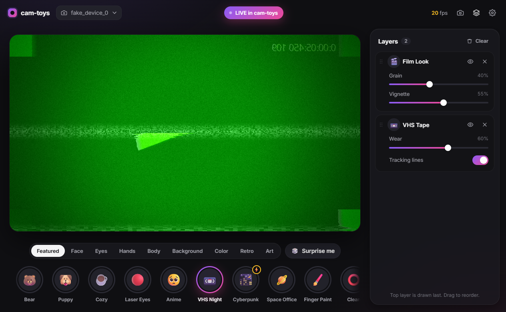

# cam-toys

Fun webcam filters for your video calls. Be a bear in Discord, shoot laser eyes in Zoom, or turn into an 80s VHS tape in Google Meet. Stack as many filters as you want.

cam-toys runs on your PC and shows up as its own camera called **cam-toys** in any app that lets you pick a camera. You don't need OBS, an account or an internet connection.



## Install (Windows 10/11)

1. Download `cam-toys-Setup-x.y.z.exe` from [**Releases**](https://github.com/AllMites/cam-toys/releases/latest).
2. Run it. Windows will probably say *"Windows protected your PC"*, because the app isn't code-signed (that costs money). Click **More info → Run anyway**.
3. Click **Yes** when Windows asks for permission. The installer needs admin rights once to register the **cam-toys** camera.
4. Open cam-toys from the Start menu or the desktop icon.

## Use it in a call

1. Open cam-toys and tap a filter, for example 🐻 **Bear**.
2. In Discord, Zoom, Meet, Teams or OBS, open the camera settings and pick **cam-toys** (not your real webcam).
   - Discord: *User Settings → Voice & Video → Camera*
   - Zoom: *Settings → Video → Camera*
   - Meet/Chrome: the ⚙️ in the call → *Video*
3. That's it. Closing the window hides it in the system tray (bottom right), and your filters keep running.

The **● LIVE in cam-toys** pill at the top glows when your call app is getting frames.

## What's in it

**Filter stacking.** Tap as many filters as you like. They stack in the **Layers** panel, where you can drag to reorder them, toggle each one and tweak its sliders.

| Category | Filters |
|---|---|
| Face | 🐻 Bear · 🐶 Puppy · 🐱 Kitty · 🐰 Bunny · 🌸 Flower Crown · 🥳 Party Hat · 😎 Deal With It · 🎃 Big Head · ✨ Beauty · 🕸️ Face Mesh · 🔵 Face Dots |
| Expressions | 🔥 Fire Breath (open your mouth) · 🌈 Rainbow Puke · 📸 Blink Flash |
| Eyes | 👀 Laser Eyes · ✨ Glowing Eyes · 🥺 Anime Eyes · 👁️ Eye Colour |
| Hands | 🖌️ Finger Paint · ✌️ Gesture FX (✌️ 👍 🤘 ✋) · ✨ Sparkle Hands · 🦴 Hand Skeleton |
| Body | 🦴 Skeleton · 👻 Ghost Trails ⚡ · ✨ Neon Outline ⚡ |
| Background | 🌫️ Blur · 🏝️ Scene Swap (space, beach, office, gradient) · 🟩 Solid colour |
| Color | 🎞️ Colour Grades (Warm, Cool, Teal-Orange, B&W, Sepia, Pastel, Cyberpunk) · 🌡️ Thermal · 🥽 Night Vision · 🔄 Invert |
| Retro | 📼 VHS · 📺 CRT · 👾 Glitch · 🕹️ Pixel Art · 🔤 ASCII |
| Art | 💥 Comic Book · 🔮 Kaleidoscope · 🪞 Mirror World · 🌈 Chromatic Split · 🎬 Film Look · 💫 Time Echo |

**Presets** (the Featured tab): Bear, Puppy, Cozy, Laser Eyes, Anime, VHS Night, Cyberpunk, Space Office, Finger Paint, Clean. Use 🎲 **Surprise me** for a random combo.

**Shortcuts**
- **Ctrl+Alt+→ / ←**: next or previous preset. Works while Discord or Zoom is focused.
- **Tray icon** (right-click): show the window, pause or resume the camera, pick a preset, quit.
- **📸** in the top bar saves a snapshot to `Pictures\cam-toys`.

⚡ filters are heavier. On laptops without a gaming GPU they can drop the frame rate, and the app warns you if that happens.

## Troubleshooting

| Problem | Fix |
|---|---|
| "Your camera is busy" | Another app is using your real webcam. In your call app, pick **cam-toys**, not your real camera, then press *Try again*. |
| cam-toys isn't in the camera list | Restart the call app. If it's still missing, reinstall cam-toys and say **Yes** to the admin prompt. |
| Call shows a frozen image | cam-toys is paused or closed. Open it from the tray and check that the pill says **LIVE**. |
| Slow / choppy | Turn off ⚡ filters, use fewer layers, or set 720p in ⚙️ Settings. |
| Windows Camera app doesn't see it | Expected: that app only lists a different kind of camera. Discord, Zoom, Chrome, Teams and OBS all work. |

## For developers

Electron + Svelte 5 + Vite + TypeScript, with MediaPipe for tracking and a WebGL2 pass chain for rendering. The virtual camera is [Softcam](https://github.com/tshino/softcam) (DirectShow).

```bash
npm install
npm run dev          # the app
npm run gallery      # filter playground in your browser
npm test             # unit checks
npm run smoke        # headless render of every filter (fake camera)
npm run build:win    # installer in dist/
```

For development, register the virtual camera once from an admin terminal: `regsvr32 "%CD%\resources\softcam.dll"` (see [docs/VCAM.md](docs/VCAM.md)).

- **Add your own filter**: [docs/ADDING_A_FILTER.md](docs/ADDING_A_FILTER.md). One file in `src/filters/<category>/` and it shows up automatically.
- **How the virtual camera works**: [docs/VCAM.md](docs/VCAM.md)
- **Releases**: push a `v*` tag and GitHub Actions builds the installer and publishes it.

## License

MIT, see [LICENSE](LICENSE). Bundled third-party software is listed in [THIRD_PARTY_NOTICES.md](THIRD_PARTY_NOTICES.md).
